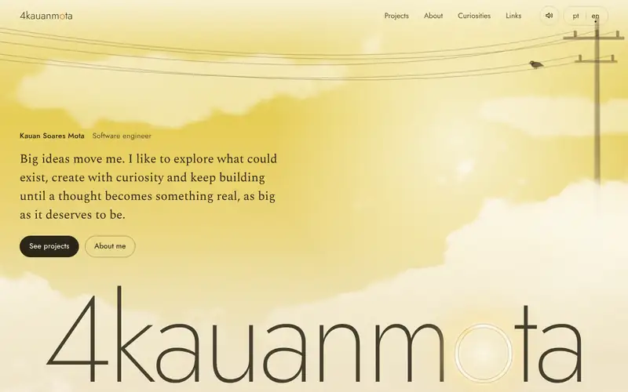
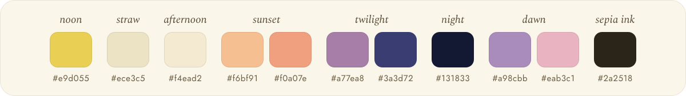

<div align="center">

<a href="https://4kauanmota.com.br"></a>

**The portfolio of Kauan Soares Mota.**<br>
A site about memories and dreams: scrolling the page is living through a whole day,<br>
from the golden noon sky to sunset, night and dawn, with no cut between one section and the next.

<a href="https://4kauanmota.com.br"></a>


</div>

<br>

<p align="center">
  
</p>

## One page, one day

The light (the "o" in the logo, the halos) carries the identity and the new chapter in games. Every section is an hour of the day, and each sky ends in the exact color where the next one begins, with clouds crossing the borders.



| Hour | Section | What happens there |
| --- | --- | --- |
| ☀️ Noon | Home | A golden sky, painted clouds and wires swaying from a pole. A little bird walks along the wire, stops, hops now and then and flies off when you get close. A flock crosses the sky. |
| 🪟 Afternoon | Projects | Window light across the room, dust in the beams, the shadow of a passing cloud, and the gallery. |
| 🌇 Sunset | About | A sun that tells a story as you scroll: it appears, gains light, loses it, swells and comes apart until it bursts like a star. Postcards of what I do today and the journey. |
| 🌙 Night | Curiosities | Stars, an old TV and a floppy drive floating in the air, and fragments of a film made of memories. Pick a floppy disk and it goes into the drive. |
| 🌅 Dawn | Links | Violet, lilac, pink and gold. A sea of clouds, the sun rising behind it and the light coming back. |

## What's inside

- **Projects straight from GitHub.** The list comes from my repositories, newest to oldest (by creation date), and updates itself. Descriptions in Portuguese and English, each project's type (WEB, APP, GAME…) and private or non-GitHub projects live in one config file. Each repository's README opens right inside the portfolio.
- **Truly bilingual.** Portuguese (the default) and English, switching without reloading the page.
- **Static.** No database, no server, no token in the browser.
- **Sounds made on the spot** with the Web Audio API. Nothing plays on its own, and the speaker button turns them off.
- **Built for everyone.** Keyboard navigation everywhere, AA contrast, screen reader announcements, and a calm version for "reduce motion".

## Quick start

You need **Node.js 22.12 or newer** and npm.

```bash
npm install
npm run dev          # http://localhost:5173 (also /en/, /links/ and /en/links/)
```

| Command | What it does |
| --- | --- |
| `npm run dev` | Development server. Uses the latest project snapshot, without calling the API. |
| `npm run sync:github` | Fetches the repositories from GitHub and updates the project snapshot (names, dates, published links) and the READMEs. |
| `npm run build` | Syncs with GitHub (if the API fails, it keeps the snapshot) and builds the site into `dist/`. |
| `npm run build:offline` | Builds the site without syncing. |
| `npm run preview` | Serves `dist/` locally, exactly as it will be published. |
| `npm test` | Tests for the project config and merging, categories, published links (including the ones that use this portfolio's address), README cleanup and fidelity, the journey layout, the sun, the film strips (geometry and whip), links, bilingual content and punctuation (no dashes in the texts). |
| `npm run typecheck` | Type checking (Vue + TypeScript). |

> [!TIP]
> Without a token, the GitHub API allows only 60 requests per hour per IP. The first sync uses about 30 (one per repository, to fetch its README); later ones use 1, plus one per repository that got a push since the last time. To sync freely, copy `.env.example` to `.env` and fill in `GITHUB_TOKEN`.

## Where to edit what

All the content lives in `src/content/`. The components only read from those files.

| I want to change… | File |
| --- | --- |
| **The portrait on the home page** | Drop the image in `src/assets/profile/` (focus and alt text in `src/content/profile.ts`) |
| The "About me" text (summary and "Read more"), the journey, the tools | `src/content/about.ts` |
| **Curiosities** (the floppy disks) | `src/content/curiosities.ts` |
| **Links and social profiles** | `src/content/links.ts` (available platforms in `platforms.ts`) |
| **A project's description** (Portuguese and English) | `src/content/projects.config.ts` → `projectDetails` |
| **A project's type** (WEB, APP, GAME, CLI…) and filters | `src/content/projects.config.ts` → `kind` and `also` |
| **The "Visit site" link** (change or hide it) | The repository's *Website* field on GitHub, or `liveUrl` in `projectDetails` |
| **A private or non-GitHub project** | `src/content/projects.config.ts` → `externalProjects` |
| **A project's image** | `src/assets/projects/` (file named after the repository or the `id`) |
| **A company logo** in the journey | `src/assets/companies/` (file named after the `company` value) |
| Hide projects, show forks | The `portfolio-hide` topic on GitHub, or `src/content/projects.config.ts` |
| Interface texts (buttons, titles, messages) | `src/i18n/messages/pt-BR.ts` and `en.ts` |
| Title and description for search engines and link previews | `src/i18n/meta.ts` |
| GitHub username, site address | `src/content/site.ts` |
| Colors, fonts and spacing | `src/styles/tokens.css` |
| Sound effects | `src/composables/sound.ts` |

## Guides

Click a guide to open it.

<details>
<summary><b>🖼️ The portrait on the home page</b></summary>
<br>

1. Put **one** image in `src/assets/profile/`, with any name (`portrait.webp`, `photo.jpg`…). WebP, AVIF, PNG, JPG, GIF and SVG all work.
2. That's it: it shows up on its own on the home page and, small, on the /links page. With `npm run dev` running, the change appears right away, without reloading.
3. To swap it, delete the old image and add the new one. No code changes. Every new image gets a new address in the build, so nobody keeps seeing the old one from cache.
4. Commit the image too: the file in that folder is what goes to the published site.

The settings live in `src/content/profile.ts` and apply to any image: `focus` (the point of the image that stays in the center of the crop, like `'50% 25%'`), `alt` (the alt text, in Portuguese and English) and `haloTop` (the height of the halo over the small portrait on the links page, so it sits right above the head). On the home page the portrait stays clean, with no halo.

With the folder empty, the portrait space stays reserved on the home page, empty, and the /links page shows no portrait. The same happens if the image fails to load. With more than one image in the folder, the first in alphabetical order wins (`npm run dev` warns in the console). The crop is 4:5, ideally around 1000 × 1250 px, and the edges dissolve into the light, so images with a simple or transparent background work best. The folder has its own `README.md` with these same steps.

</details>

<details>
<summary><b>🌇 About me and the journey</b></summary>
<br>

In `src/content/about.ts`:

- `aboutSummary` is the summary that is always visible; `aboutMore` holds the paragraphs that open with **Read more**. Together they form a single text that flows like a magazine page: while the "what I do today" postcards take the right side, the text stays to their left; when they end, the text uses the full width, with no breaks. On narrow screens the postcards come after the text. The languages close the letter.
- Each `timeline` item has a lane (`lane`: `study`, `work` or `games`) and a start and end in the `'YYYY-MM'` or `'YYYY-MM-DD'` format, in any order: the journey arranges itself by date. Without `end`, the item runs until today.
- **Sized by time:** each experience has a line as long as its real duration (an education entry runs until its end, even with other things happening in between). The box always keeps the natural size of its text and, as you scroll, travels down along its own line while it lasts; the line continues past the box when the experience is longer than the text. When the text is longer than the duration, the line grows just enough for the box to fit, without running over the next one. Things that happened at the same time sit side by side: a single item is centered, two split the space in half, three or more split it evenly. If the screen can't hold every column, they redistribute; on phones the cards stack, with parallel threads showing what happened at the same time. Nothing has a fixed position.
- **Experience texts:** the ones for Prefeitura de Juiz de Fora, Compass UOL and Afilio are the ones from LinkedIn, with the Portuguese untouched (the English is the translation); Compass UOL also has the AWS Certified Cloud Practitioner sentence (earned during that period). The ones for Instituto Vianna Júnior and LEVTY were written for the portfolio. To change one, edit the item's `text`; a blank line (`\n\n`) separates paragraphs. The text shows in the journey and, for experiences that are still ongoing, also on the "what I do today" postcard.
- **Logos:** the `company` field links the item to a logo in `src/assets/companies/` (see the company logos guide). Without a file, the item shows normally, just without a logo.
- The journey ends in a halo of orbiting stars: the "now" (tapping it rings a little bell).
- **What I do today:** the postcards next to the summary come from the journey itself (the items without `end`), so there is nothing to keep in two places.
- The languages you speak (`spokenLanguages`) appear inside the summary itself, with no separate area.

</details>

<details>
<summary><b>💾 Curiosities (the floppy disks)</b></summary>
<br>

Each item becomes a floppy disk. To add one, copy a block in `src/content/curiosities.ts`, change the `id` and fill in both languages. The comment at the top of the file has the same template.

```ts
{
  id: 'favorite-game',
  topic: { 'pt-BR': 'jogo favorito', en: 'favorite game' },      // written on the disk label
  answer: { 'pt-BR': 'Nome do jogo', en: 'Game name' },          // the short answer
  note: { 'pt-BR': 'Por que eu gosto…', en: 'Why I like it…' },  // the why
  image: { src: 'images/curiosities/game.webp', alt: { 'pt-BR': '…', en: '…' } }, // optional, file in public/images/curiosities/
  color: 'blue', // lilac | pink | blue | mint | yellow | peach (optional)
},
```

An item with `draft: true` only shows up in `npm run dev`, never on the published site.

Picking a floppy disk puts it in the drive and shows its content on the screen: the disk flies to the drive's slot, the screen glitches as it turns on and radio waves ripple out of the TV. Picking another one ejects the current disk (it flies back to the box) before the new one goes in, so the screen never shows two memories at once. The arrow keys move between disks, Enter inserts and the drive's button ejects. When the text is long, the screen grows slowly to fit it.

**Film strips:** fragments of a film made of memories, floating in the air along the edges of the screen (past the content width, into the sides), in different directions (upright, lying down, diagonal and curved) and at three depths: the far and middle ones pass behind the TV and the box; the near ones sit in front, in the free corners. They are delicate, a complement to the scene: very transparent, low contrast and in pastel tones. None of them holds or connects the devices: the TV and the drive float on their own. The film is an old rose, barely saturated (a soft echo of the red of developed film), with real cut-out perforations, edges that catch a little of the TV's light, grain, a thin projector scratch and a peach light burn at the ends. Each frame lets a rosy light through, and **every frame holds a memory drawn as a dark, soft silhouette**, framed like a photo (sometimes a piece falls outside the frame): families walking, two people on a bench, someone in the rain with an umbrella, a shared umbrella, a kite, a walk with the dog, a swing, a picnic, mountains, the sea, a lighthouse, a house, a bicycle, birds on a wire, moon and stars, a shooting star, a balloon, a cat at the window, a hug, a Ferris wheel, a boat on a lake, reading under a lamppost, pine trees, a sunset for two, a paper plane and a campfire. The drawings spread across the scene without repeating side by side, and always stand upright inside the frame. Each fragment drifts at its own pace (the far ones stay still), so the sky feels alive without everything moving together. The composition rebuilds itself for every screen width, from the position of the TV, the drive, the box and the texts (`src/components/curiosities/FilmScene.vue`; the geometry is in `src/lib/film.ts` and the drawings in `src/lib/memories.ts`).

**The wave in the strips:** when the floppy disk settles in the drive, besides the TV's radio waves, a wave is born at the slot and runs through the fragments, the near ones first and then the far ones, bending each one along its length until it fades away. Back-to-back insertions add their waves together, and in the end everything returns exactly to rest.

</details>

<details>
<summary><b>🔗 Links</b></summary>
<br>

In `src/content/links.ts`, each line is a link, in the order it appears: GitHub, LinkedIn, your profile on the Pixel Mole site (`pixelmole.com.br/members/4kauanmota`, with the common link symbol, a chain, in the same style as the other icons) and email. Only confirmed profiles go in; there are commented examples for itch.io and Instagram. The **Links** section and the **/links** page (made for social media bios, and linked right below "Everywhere, 4kauanmota." in the Links section) use the same list. The /links page is compact: portrait, name and a panel with just the links (the email has a copy button).

</details>

<details>
<summary><b>🏷️ Project descriptions, types and links</b></summary>
<br>

Everything lives in `src/content/projects.config.ts`, in `projectDetails`, with one entry per repository:

```ts
'dev-calc-web': {
  kind: 'web',                       // WEB, APP, GAME… (tag next to the name and main filter)
  also: ['tools'],                   // optional: other filters the project shows up in
  liveUrl: 'https://devcalc.app/',   // optional: replaces the "Visit site" link; null hides the button
  description: {
    'pt-BR': 'Calculadora que usa a sintaxe das linguagens de programação…',
    en: 'A calculator that uses programming language syntax…',
  },
},
```

- **Types:** `web`, `app`, `game`, `cli`, `api`, `ai` and `lib`. On the site: WEB, APP, JOGO (GAME in English), CLI, API, IA (AI in English) and LIB, always in capitals next to the name. The type only comes from here (or, for a repository without an entry, from its topics and language), never from words in the name.
- **Descriptions:** the current ones were written from each repository's README and code. Three lines fit on the card (up to about 150 characters). `space-portfolio-web` and `forum-web` have no README or description on GitHub, so they have no description (`null`) until you write one. Without a description, the space stays empty: nothing is made up.
- The GitHub description (*About*) is no longer used on the site.

</details>

<details>
<summary><b>🧹 Curating without touching code</b></summary>
<br>

Use **topics** on the GitHub repositories:

| Topic | Effect |
| --- | --- |
| `portfolio-hide` | Hides the project from the site. |
| `game`, `godot`, `gamedev`, `game-jam`… | A repository without an entry in the config goes into the **Games** filter with the GAME tag. |

In `src/content/projects.config.ts` you can also hide repositories by name (`hidden`) and include forks (`includeForks`).

</details>

<details>
<summary><b>🗂️ Projects outside GitHub</b></summary>
<br>

Private projects, client work or projects kept in another service go into `externalProjects`, in the same file. Each item becomes a card just like the others, placed by its date, with the same filters and animations. No component needs to change.

```ts
export const externalProjects: ExternalProject[] = [
  {
    id: 'loja-da-ana',               // required: unique, lowercase and hyphens (also the image name)
    title: 'Loja da Ana',            // required
    kind: 'web',                     // required
    createdAt: '2026-05',            // required: 'YYYY-MM-DD' or 'YYYY-MM'
    description: { 'pt-BR': '…', en: '…' }, // required (can be null)
    private: true,                   // optional: shows "Private code" and never shows the repository
    liveUrl: 'https://lojadaana.com.br/', // optional: "Visit site" button
    repoUrl: 'https://gitlab.com/…', // optional: repository in another service (ignored if private)
    image: '/projetos/loja.png',     // optional: https or a file in public/; without it, src/assets/projects/<id> is used
    language: 'Vue',                 // optional: shows on the generic artwork
    also: ['apps'],                  // optional: other filters
  },
]
```

- **Private:** the card shows a discreet "Private code" note instead of the repository button. The repository address never reaches the page, even if it is in the file.
- **No duplicates:** if the project becomes public on GitHub (same `id` or same `repoUrl`), the GitHub one wins and this item is ignored. The tests and the build log warn about it.
- Never put tokens or passwords in this file: it goes to the browser.

</details>

<details>
<summary><b>📸 Project images</b></summary>
<br>

Put the image in `src/assets/projects/`, named after **the repository** (or the `id` of a non-GitHub project), for example `src/assets/projects/4notes-app.webp`. The site finds it on its own; without an image, the card uses the site's artwork.

- Formats: `.webp`, `.avif`, `.png`, `.jpg`, `.jpeg`, `.gif` and `.svg`. Upper or lower case in the name doesn't matter. With two files for the same project, the first in that list wins (and the build warns).
- **Screenshot:** ideally 16:10 (for example 1600 × 1000 px). It fills the card image from the top; in other proportions, the extra is cropped.
- **Logo or icon:** nearly square images show whole, centered over the project's artwork. PNG with a transparent background or SVG look best.
- Renamed the repository? Rename the image too.

Discovery happens in the build (a Vite plugin reads the folder), so it works the same on Vercel, with no extra request in the browser. In the build, the images become light WebP files with versioned names.

</details>

<details>
<summary><b>🏢 Company logos</b></summary>
<br>

The journey's logos live in `src/assets/companies/`, named after the item's `company` field (in `src/content/about.ts`):

| Experience | File |
| --- | --- |
| Instituto Vianna Júnior | `instituto-vianna-junior.jpg` |
| Prefeitura de Juiz de Fora | `prefeitura-de-juiz-de-fora.png` |
| Compass UOL | `compass-uol.jpg` |
| Afilio | `afilio.jpg` |
| LEVTY | `levty.jpg` |
| Pixel Mole | `pixel-mole.webp` (the studio's mascot) |

- Formats: `.svg`, `.png`, `.webp`, `.jpg`, `.jpeg` and `.avif`, ideally with a transparent background and no large margin around it.
- New company: pick a lowercase name with hyphens, add `company: 'chosen-name'` to the item and save the image with that name.
- In the journey, the logo sits on a small light badge, with gently rounded corners and its own proportions (never stretched), so it reads well over the sunset. The "what I do today" postcards wear it like a stamp. Without a file, there is no broken image or empty space. Since the images go through Vite, they work the same on Vercel.

</details>

<details>
<summary><b>🌐 Languages</b></summary>
<br>

- Portuguese is the default (`/`); English lives at `/en/`. The links page is `/links/` and `/en/links/`, and opens directly from its address.
- The build generates one HTML file per page and language, with the right `lang`, title, description, `hreflang`, canonical link and social preview, for search engines and apps that don't run JavaScript.
- Switching languages doesn't reload the page: the text rebuilds with a soft transition, the URL and metadata update and the choice is saved in the browser.
- The interface texts live in `src/i18n/messages/`. `en.ts` is typed from `pt-BR.ts`, so TypeScript warns if a translation is missing.
- Proper names, project names and technology names are not translated.

</details>

<details>
<summary><b>🔊 Sounds</b></summary>
<br>

The sound effects (inserting and ejecting a floppy disk, the radio waves, opening and closing a README, picking a filter, the little bird, the bell of the halo, copying the email) are **synthesized on the spot** with the Web Audio API: there is no audio file to download and no external service.

- Nothing plays when the page opens. Sound only starts after a gesture (a click, tap or key press), as browsers require; hovering doesn't count.
- The speaker button in the header turns sounds on and off, and the choice is saved in the browser.
- The sounds live in `src/composables/sound.ts`, each one a short recipe.

</details>

## How the GitHub integration works

**Why at build time and not in the browser:** the public API without a token allows 60 requests per hour *per visitor*, and any shared network would hit the limit. A token can't go to the browser either. So the site fetches everything **during the build**, with the token kept only on the server, and ships a ready, fast file.

The `scripts/sync-github.ts` script:

1. Lists the public repositories of `4kauanmota`. Forks, the profile repository and anything with the `portfolio-hide` topic are left out.
2. Sorts them by the repository's **creation date**, newest to oldest (the update date doesn't change the order).
3. Builds the name from the repository name, without your naming suffix (`manda-trends-web` → "Manda Trends", `food-api` → "Food"): the type shows on the tag next to the name, without repeating it.
4. Downloads each repository's README and converts it to HTML **at build time** (see the README reader below). A repository with no push since the last sync reuses the README already converted, without spending a request. Without a README, the **Read the project's README** button doesn't show.
5. Checks whether the published site (the repository's *Website* field or GitHub Pages) responds. Links that are down are left out. A link that uses an address of this portfolio (`4kauanmota.com.br` or the Vercel one, in `src/content/site.ts`) is only removed if the page published there really is this portfolio (the script opens the page and looks for its signature): today `space-portfolio-web` points to `4kauanmota.vercel.app`, where the old portfolio still lives, so **Visit site** shows. Once this portfolio takes over that address, the link goes away on its own in the next sync. Without a network to check, the link is only removed if the address is the deploy's own (`SITE_URL` or Vercel's production domain).
6. Writes `src/generated/projects.json` and one file per README in `src/generated/readmes/`, which go into the site.
7. Prints a summary in the log: which projects have the **Visit site** button (and whether the link came from GitHub or from the config), which ones have no description and which repositories don't have an entry in the config yet.

In the browser, the GitHub list is merged with `src/content/projects.config.ts` (descriptions, types, links and non-GitHub projects). What is edited by hand never comes from GitHub, and what comes from GitHub never needs to be copied into the config.

A new repository shows up on its own in the next build, at the top of the list (it is the most recent), with the type suggested by its topics and language and no description, until you fill in its entry. If the API fails during the build, the site uses the last saved snapshot and stays up. If the API limit runs out halfway, the list and the new links are saved anyway.

> [!NOTE]
> **"Visit site" didn't show up after filling in the *Website* field on GitHub?** The site is generated at build time, so the change only shows in a new deploy: push, redeploy on Vercel or set up the [automatic project refresh](#automatic-project-refresh). Without `GITHUB_TOKEN`, Vercel may hit the API limit and use the old snapshot; the build log lists the links it found. To set the link without depending on GitHub, use `liveUrl` in `projectDetails`.

<details>
<summary><b>📖 The README reader</b></summary>
<br>

The **Read the project's README** button opens the README inside the portfolio, in a reading window (instead of sending people to GitHub). Headings, lists, tables (which scroll sideways on phones), code blocks, quotes, GitHub alerts (`> [!NOTE]`…), task lists and images are all formatted; with three headings or more, a table of contents appears. It closes with the X, with Esc, by clicking outside or with the browser's back button, and the focus returns to the card.

**Faithful to GitHub:** the alignment the README asks for is respected (`<p align="center">`, `<div align="center">`, centered images and headings, images with `align="left"` or `align="right"` beside the text and table column alignment). Images and badges sit side by side like on GitHub, without stretching; wide images never go past the reader's width. Images made only for GitHub's dark theme (`#gh-dark-mode-only` and `<picture>` with `prefers-color-scheme: dark`) are left out, so they don't show twice.

**Security:** the README is outside content, so it is treated as untrusted. It is converted at build time with `marked` and goes through `sanitize-html` with a closed list of what may stay: no scripts, `iframe`, forms, `style`, event attributes (`onclick`…) or inline SVG; links only `https:` and `mailto:`; images only `https:`. Relative links and images point to the repository on GitHub. No token ever reaches the browser: the site only loads the already clean HTML, and only when someone opens the reader.

</details>

<details>
<summary><b>🖼️ The gallery</b></summary>
<br>

All cards have the same size: image, name with the type tag, description in the site's language, creation date (as a stamp on the image) and the buttons for the site, the repository and the README. While a project's image loads, the photo shows a small patch of sky where a constellation forms (each project with its own, each card in its own time); when the image arrives, the sky dissolves into it. The photo space is always the same, so nothing jumps. If the image fails, or takes more than 20 seconds, the site's artwork takes its place (and the image still shows if it arrives later). The gallery starts with the first projects (two rows on desktop, three cards on phones) and opens with **Show more** (and closes with **Show less**), always newest to oldest, even with a filter picked.

With the mouse over a card, it rises a little, a light follows the pointer and the image drifts slowly the other way, like a photo with depth. The card doesn't change size and nothing covers the buttons. With the keyboard, focusing any button on the card gives it the same highlight.

</details>

## Deploying on Vercel

The portfolio's address is `4kauanmota.com.br` (the `defaultUrl` in `src/content/site.ts`). The current portfolio is on Vercel, so that is the most direct path.

> [!IMPORTANT]
> **Before creating the repository:** don't use `4kauanmota/4kauanmota`. That one is your GitHub profile README, and this project's README would replace it. A name that follows your convention is `4kauanmota-web`.

1. Create the repository on GitHub and push this project.
2. On Vercel, import the repository. The framework (Vite), the command (`npm run build`) and the folder (`dist`) are detected on their own, and `vercel.json` sets the rest. Project images are converted in Vercel's own build (`sharp` is installed with it).
3. In *Settings › Environment Variables*, add `GITHUB_TOKEN`: a *fine-grained token* created at [github.com/settings/personal-access-tokens](https://github.com/settings/personal-access-tokens/new), with no extra permissions (read-only access to public repositories is enough). It only raises the API limit; everything works without it, with the lower limit.
4. In *Settings › Domains*, add `4kauanmota.com.br` (and, if you want, `www.4kauanmota.com.br` redirecting to it). Vercel shows the DNS records to create at registro.br; copy the values exactly as they appear there. Once the domain is active, the canonical address, the sitemap and the sharing tags use the production domain on their own. If you publish at another address, set `SITE_URL`.
5. The `4kauanmota.vercel.app` address still belongs to the old portfolio. If you want it to lead here too, connect the old Vercel project to this repository (*Settings › Git*) or remove the domain from the old project and add it to this one (*Settings › Domains*).

### Automatic project refresh

Vercel publishes again on every push. To pick up new repositories and new site links (GitHub's *Website* field) without a push:

1. On Vercel, in *Settings › Git › Deploy Hooks*, create a hook (for example "refresh projects") and copy its URL.
2. On GitHub, in the portfolio repository's *Settings › Secrets and variables › Actions*, create the `VERCEL_DEPLOY_HOOK` secret with that URL.
3. The `.github/workflows/refresh-projects.yml` workflow triggers a deploy every day at 6:17 (Brasília time). It can also be run by hand in the *Actions* tab.

The `ci.yml` workflow runs the tests, type checking and the build on every push.

### Other hosts

The build output is static: it works on Netlify, Cloudflare Pages or GitHub Pages. To publish as a GitHub Pages project (`4kauanmota.github.io/repo-name/`), run the build with `BASE_PATH=/repo-name/`.

## Project structure

```text
├── index.html                 # HTML template (the build makes one copy per page and language)
├── vite.config.ts             # Vue + plugins: project images, HTML per language, sitemap and robots.txt
├── docs/readme/               # the images in this README
├── scripts/
│   ├── sync-github.ts         # GitHub sync
│   ├── lib/                   # API client, names and categories, README (clean Markdown), link checks
│   └── vite/project-images.ts # finds and optimizes the project images
├── src/
│   ├── content/               # all the editable content
│   ├── assets/
│   │   ├── profile/           # the home page portrait (any name, one image)
│   │   ├── projects/          # project images (named after the repository)
│   │   ├── companies/         # company logos for the journey
│   │   └── textures/          # painted clouds used in the sky
│   ├── i18n/                  # interface translations, routes and metadata
│   ├── generated/             # project and README snapshot (generated; don't edit)
│   ├── components/
│   │   ├── atmosphere/        # the sky for each hour of the day, halos, film grain
│   │   ├── brand/             # the logo
│   │   ├── hero/ projects/ about/ curiosities/ links/ layout/
│   ├── composables/           # scroll scene (depth), open and close, sections, projects, README, sounds, portrait
│   ├── lib/                   # types, project merging, addresses, journey layout, wire and film geometry
│   ├── directives/            # v-reveal (elements entering the screen)
│   ├── pages/                 # home, /links and 404
│   └── styles/                # tokens (colors, fonts) and base
├── public/
│   └── images/curiosities/    # images for the floppy disks (create it when you need it)
└── tests/                     # tests (node:test)
```

## Visual identity



**Concept:** a whole day of memories. Every section is an hour of the day, and the page never cuts from one to the next: each sky ends in the same color where the next one begins, and clouds cross the borders.

**Logo:** the "o" in 4kauanmota is the light itself. Large, it becomes a glowing ring with a light that slowly runs around it; small (header, footer), it is a lit golden "o".

**Halos:** each one has its own shape: a ring of particles (the portrait on the links page), orbiting stars (the "now", at the end of the journey) and a broken ring (the 404 page). The home portrait and the curiosities have no halo.

**Palette:** everything lives in `src/styles/tokens.css`. The floppy disks use pastel tones (lilac, pink, blue, mint, yellow and peach).

**Typography:** *Jost* (geometric and thin, with the round "o" that becomes light in the logo), *Spectral* (a delicate serif for the texts) and *Nanum Pen Script* (handwriting, only on the floppy disk labels).

<details>
<summary><b>☀️ What each hour looks like, in detail</b></summary>
<br>

| Section | Hour | What shows up |
| --- | --- | --- |
| Home | Noon | A golden sky, painted clouds, wires swaying from a pole (with a little bird that takes a few steps along the wire, stops, hops now and then and flies off when you get close), a flock crossing the sky and the portrait, clean, right in the sky |
| Projects | Afternoon | Window light across the room, dust in the beams and the shadow of a passing cloud; the gallery |
| About | Sunset | A sun that tells a story as you scroll: it appears discreetly, gains light, loses it, swells and slowly comes apart (shape, light and intensity) until it bursts like a star, into particles and fragments that fade out. Everything follows the scroll and comes back when you scroll up. A bank of clouds with sparks of light, loose clouds and birds; postcards of what I do today, the areas with stars of the same family (a radiant sun, an orbiting star, a shooting star, a constellation, a crowned sun and a guiding star) and the journey |
| Curiosities | Night | Stars, four-point stars and shooting stars; the TV and the floppy drive floating, linked by their cable; fragments of a film of memories around them, each frame with a silhouette drawing, in pastel tones; radio waves when a disk goes in |
| Links | Dawn | Violet, lilac, pink and gold; a sea of clouds, the sun rising behind it and the light coming back |

</details>

## Accessibility and motion

- Keyboard navigation everywhere, with visible focus and a "Skip to content" link.
- AA contrast on every layer (checked with axe-core).
- The mobile menu uses the native `<dialog>`: focus is trapped, Esc closes it and the focus returns to the button that opened it.
- Project cards get the same highlight with the mouse and with keyboard focus; the effect that follows the pointer only exists with a mouse.
- **Show more**, **Read more** and the floppy disks announce their state (`aria-expanded`, `aria-pressed`) and what changed to screen readers; collapsed text doesn't take focus.
- Texts in another language get the right `lang` attribute, so screen readers pronounce them properly.
- The README reader is a `<dialog>` with a title, focus trapped while open and focus returned on close; its body scrolls with the keyboard.
- With "reduce motion" turned on in the system, halos, clouds, wires, film strips, birds, scroll depth and transitions stop, the floppy disks swap without flying, the strips don't sway, the little bird stays still on the wire, the image loading shows the constellation already formed and the sun stays still in the sky, without coming apart or bursting; nothing depends on animation to be understood.
- The language switch uses the same font, size and weight as the menu, and marks the chosen language with the same little light as the current section (plus `aria-pressed` for screen readers).
- Scroll depth only uses `transform` and is softer on phones: background, ornaments and illustrations move at different speeds, while titles, texts and buttons stay put, for reading, for clicking and so they never touch each other. Animations of sections off screen are paused, and the sun is only drawn while it is near the screen.
- **Light on every browser:** the film strips are only redrawn while the wave is visibly moving them (about 30 times per second, and each strip stops as soon as its sway is under half a pixel), and when the TV screen grows they settle once and glide into place instead of being rebuilt on every frame. The radio waves and the screen's static are drawn with gradients, with no blur being redone on every frame.
- The big logo (4kauanmota) and the Projects title are lettering drawings and can't be selected; all the other text stays selectable.
- Sounds never play on their own and can be turned off in the header.

## Credits

- Fonts: Jost, Spectral and Nanum Pen Script (SIL Open Font License), via Fontsource, served by the site itself.
- Brand icons: [Simple Icons](https://simpleicons.org) (CC0).
- Clouds, skies, halos and illustrations were made for this site.

<p align="center"><sub>Made of memories and dreams.</sub></p>
